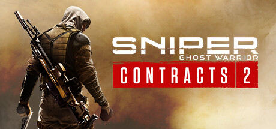

**Sniper Ghost Warrior Contracts is the open-world tactical sniping game set in Siberia, featuring realistic bullet physics with a dynamic mask HUD that provides environmental data for long-range shots. Features distinct contract objectives across large sandbox regions.**

---

## 📖 About

Sniper Ghost Warrior Contracts is the open-world tactical sniping game set in Siberia, featuring realistic bullet physics with a dynamic mask HUD that provides environmental data for long-range shots. Features distinct contract objectives across large sandbox regions.

## ⚠️ Problems Without Trainer

| Problem | Status |
|---------|--------|
| **Bullet Calculation** — Wind, distance, and elevation must all be factored for long shots | ✅ Solved |
| **Enemy Snipers** — Opposing sharpshooters can one-shot you from distances you haven't spotted | ✅ Solved |
| **Contract Conditions** — Some contracts require specific silent kills under time pressure | ✅ Solved |
| **Exfil Requirement** — Missing extraction deadlines fails contracts without warning | ✅ Solved |

## ✅ Solution

The **Sniper Ghost Warrior Contracts Trainer** solves all these issues by giving you complete control over the game.

## 🎯 Full Feature List

- Unlimited Resources
- God Mode / Invincibility
- Instant Skill Cooldown
- One-Hit Kill
- Freeze Game Timer
- Unlock All Items & Achievements
- Custom Speed Multiplier
- Save State Anywhere

## 🚀 Quick Start

1. **Disable Windows Defender** temporarily (trainer may trigger false positive)
2. Download the trainer from the button above
3. Launch Sniper Ghost Warrior Contracts
4. Run the trainer as Administrator
5. Activate desired cheats with hotkeys

## 💎 Free vs Paid

| Feature | Free | Pro |
|---------|------|-----|
| Basic God Mode | ✅ | ✅ |
| Unlimited Resources | ✅ | ✅ |
| All Advanced Cheats | ❌ | ✅ |
| Auto-Updates | ❌ | ✅ |
| Priority Support | ❌ | ✅ |

## 💻 Requirements

- Windows 10/11 (64-bit)
- Sniper Ghost Warrior Contracts (any version)
- .NET Framework 4.8+
- DirectX 11+

## 🍎 macOS

macOS users can use our alternative tool:

## ⚖️ Legal

This trainer is for educational and single-player use only. Use responsibly.

---

